# Design direction proposals

Phase 1 of the UI/UX redesign: three visual directions for Personal OS, each shown on the real Home, All Tasks and Habits screens.

**Nothing in `src/` has changed.** The prototypes are static HTML files under `docs/design-direction/prototypes/`.

**What doesn't change** in any direction:

- the product truth in `PRODUCT.md`
- every feature and the data model
- the decisions of 2026-11-19 (open on Today, Habits only on the Habits page, phone tabs Home · Today · ＋ · Tasks · More, no evening wrap-up)
- the binding rule that **colour means life area**

## How to view them

1. Run `npm run dev`. Vite serves the project root, so the prototypes are at `http://localhost:5173/docs/design-direction/prototypes/` (the port may differ).
2. Change the window to phone width to see the phone layout, and switch your OS between light and dark to see both themes.
3. Static captures are in `docs/design-direction/screenshots/<direction>-<screen>/`, at 1440×900 and 390×844 (dark theme).
4. To rebuild the prototypes, run `node docs/design-direction/prototypes/build.mjs`. It reads its icons from the installed `lucide-react`.

All three directions use the same content (the Researcher profile on Fri 20 Nov, 09:40) and the same navigation model. Only the world changes: type, palette, density and one signature move.

## How the directions were found

**Method.** The `impeccable` and `frontend-design` skills were applied in this order:

1. Product truth was captured in `PRODUCT.md` (you confirmed: you first and others later, the name stays "Personal OS", and colour means area).
2. Seven grounded worlds were drawn from your own life as a graduate researcher, not from productivity apps:
   - the lab notebook
   - the university course timetable and attendance register
   - transit line diagrams
   - the arXiv preprint
   - the engineering drawing's title block
   - railway departure boards
   - stationery index dividers
3. A random roll then assigned which grounded world leads, so the proposal doesn't drift to the category default. It also dealt six outside "challenger" worlds, each judged on two axes: does the audience recognise it, and does the product stay clear?

**The rut both skills name, and why none of the three is it:**

- graphite and violet in the Linear style
- cream paper with a serif and a terracotta accent
- near-black with one neon accent
- broadsheet hairlines
- the SaaS card kit

The current app sits closest to the first. None of the three directions below does.

**Comparison:**

|                   | A. Timetable                                                 | B. Divider tabs                                                               | C. Lines                                                   |
| ----------------- | ------------------------------------------------------------ | ----------------------------------------------------------------------------- | ---------------------------------------------------------- |
| Comes from        | The course timetable and the attendance register             | A reference manual's coloured section dividers                                | A transit line diagram                                     |
| How it was chosen | **The roll** (grounded candidate 3)                          | **Challenger** (catalog `rw-manual-acetate-tab-board`), verdict _competitive_ | **Impeccable's pick** (top-ranked grounded candidate)      |
| Signature move    | The day set on a time axis; habits as an attendance register | A tab rail down the right edge: one tab per area, height ∝ open items         | Areas drawn as lines, sections as stations, tasks as stops |
| Colour strategy   | Restrained, with a coloured ink-blue shell                   | Committed: full-strength area colour as tabs and headers                      | Restrained ground, area colours as thick lines             |
| Typeface          | Public Sans                                                  | Archivo (two widths)                                                          | Overpass                                                   |
| Density           | Highest                                                      | Medium                                                                        | Medium–low                                                 |
| Main risk         | Can feel administrative if rules multiply                    | Strong colour fields may tire over long sessions                              | Rings and lines add visual weight to long lists            |

---

## A. Timetable

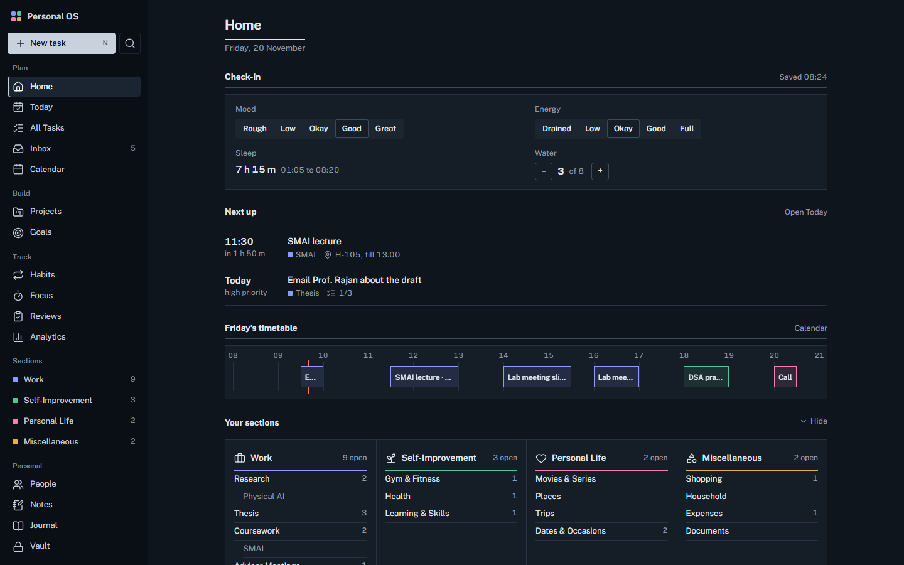

**The idea.** Your days are already organised as a printed course timetable and an attendance register. Personal OS uses that grammar for the whole of life:

- the day is ruled into periods
- every item carries its area like a course code
- habits are marked in a register, one letter per day

### 1. Personality

Precise, institutional and calm, like a well-set registrar's sheet. It is quiet because it is ordered, not because it is empty. Rank comes from weight and rules, not from size.

### 2. Colour

| Role                          | Light                                         | Dark                                          | Use                                                 |
| ----------------------------- | --------------------------------------------- | --------------------------------------------- | --------------------------------------------------- |
| Ground                        | `#f3f5f7` (cool sheet, not cream)             | `#0f151c`                                     | Page                                                |
| Surface                       | `#ffffff`                                     | `#151d26`                                     | Tables, the check-in                                |
| Rule / strong rule            | `#d5dbe2` / `#a3afbc`                         | `#263241` / `#3c4a5b`                         | Hairlines; table heads                              |
| Ink / muted                   | `#17202b` / `#596574` (5.4:1)                 | `#e3e8ee` / `#8f9bab` (6.5:1)                 | Text                                                |
| Shell                         | `#1b2735` ink blue                            | `#0a0f15`                                     | Sidebar and phone tab bar: the coloured shell       |
| Work · Self · Personal · Misc | `#3b4fc8` · `#1d8556` · `#b3367a` · `#a26b0a` | `#8c9bff` · `#57c792` · `#f07fb5` · `#e3b04b` | Area only: period rules, sidebar squares, map heads |
| Danger                        | `#c4401a`                                     | `#ff7a52`                                     | Overdue, missed, the "now" line                     |

- **Done is not a colour.** It is an ink tick (✓) in light and dark, so the area colours never double as status. This answers audit C2.
- **Light or dark.** The use scene (hostel desk at night, lab bench in daylight, phone between classes) needs both, so it follows the system setting. The ink-blue shell keeps the identity in both themes.

### 3. Typography

- **Public Sans**, one family: an institutional grotesque with tabular figures and no display face.
- **Three sizes:** 21 px titles (with a 2 px rule under the H1, like a sheet heading), 14 px body, 12.5 px meta.
- **Rank** comes from weight (700, 600, 500) and rules.
- **Times and counts** are tabular, so columns line up.

### 4. Navigation and sidebar

- The same groups as today (Plan, Build, Track, Sections, Personal; Settings and Trash at the foot), on an ink-blue shell.
- The active item gets a raised panel and a 2 px light edge.
- Section rows carry a square area chip and an open count.
- On phones, the same ink-blue bar holds Home · Today · ＋ · Tasks · More.

### 5. Layout and density

- **The page is a sheet:**
  - blocks are headed by a rule, not wrapped in cards
  - tables are the only boxed elements
  - this fixes H1 (cards in cards)
- **Rows:** 36–40 px on desktop, 44 px+ on phones.
- **Width:** content up to 1040 px. Tasks and Habits can widen.

### 6. Cards and components

Almost none.

- **Check-in:** one bordered table.
- **Section map:** a four-column ruled table with a coloured rule under each area head.
- **Task row:** a time column with the area's colour as its right rule, then the check, title and meta. This is the one row anatomy for every screen (fixes H3).

### 7. Buttons, inputs, interaction

- 4 px radii throughout, and the same for checks and cells.
- **Buttons:** ink primary, outlined secondary, ghost.
- **Segmented control:** a sunken track with a raised white "on" key.
- **Inputs:** bordered and square, with the destination shown in the add box ("Goes to Inbox").
- **Focus:** a 2 px Work-blue ring.
- **Motion:** state changes only; the check ticks in place.

### 8. Icons

- lucide at 1.75 stroke (as now), 18 px in navigation and 14 px in meta.
- Area chips are small squares, like course-code marks.

### 9. Themes

- **Light:** cool sheet and ink.
- **Dark:** a deep ink-blue night, not graphite, so dark mode keeps the same identity.
- Both pass AA for body and muted text.

### 10. Desktop and phone

- **Desktop:** a wide timetable strip on Home, and a register with a full week of columns.
- **Phone:**
  - the register puts the habit name above a seven-cell row of 44 px cells
  - the timetable strip drops labels on short blocks
  - Tasks keeps the time column at 56 px

**Signature in use**

- **Home:** "Friday's timetable" is a 08–21 time axis with the now-line, so the day's load is visible.
- **Tasks:** times run down the left edge like periods.
- **Habits:**
  - the register uses ✓, S, R and – (missed), with a hollow ring for "due today"
  - today's column is boxed and its date underlined
  - every state is readable without colour

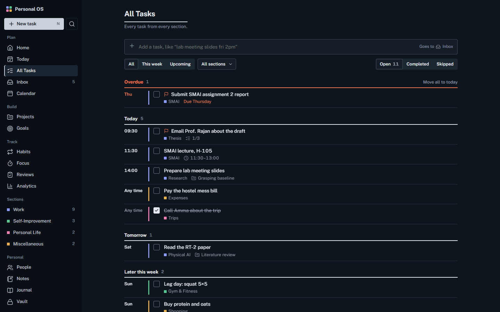
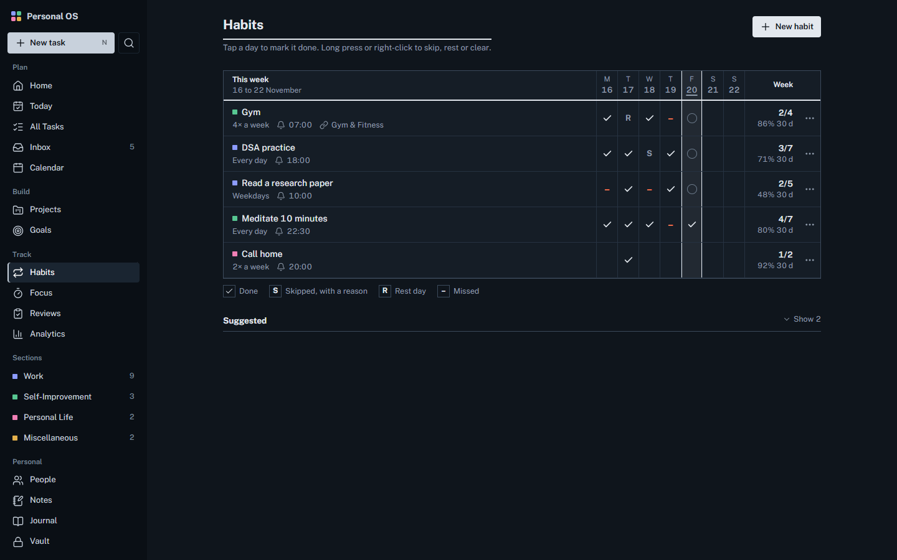
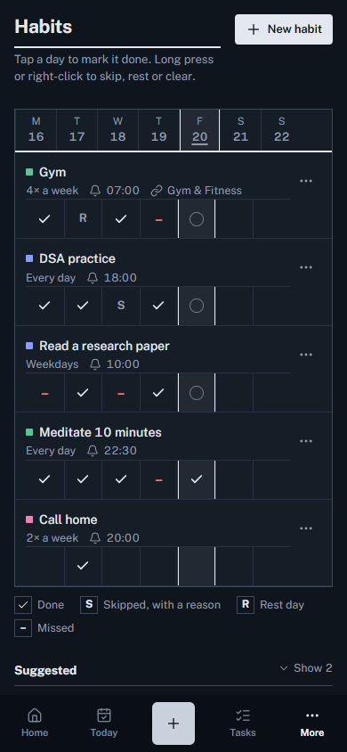

**What it took from the declined challengers.** Each line names the donor and the discipline borrowed:

- _Pocket timetable slide rack:_ rank by weight, case and rule, never by big type (three sizes only).
- _Japanese high-density web:_ a strict hairline system with no padding inflation, so more of the day fits in one view.
- _Doujin event catalog:_ the habit grid repacks in whole cells, and a marked cell is a mark, not a fill.
- _Crouwel grid specimen:_ the grid is visible and every component snaps to it (rules at the column lines of the register and the map).
- _Ikeda datamatics:_ one numeric voice: all numbers tabular, in the same face.

**Honest risk**

- If rules multiply, it can drift towards "government form".
- Short blocks on the timetable truncate; the build needs a rule for items under 45 minutes, such as a tick mark with the label on hover or tap.

---

## B. Divider tabs

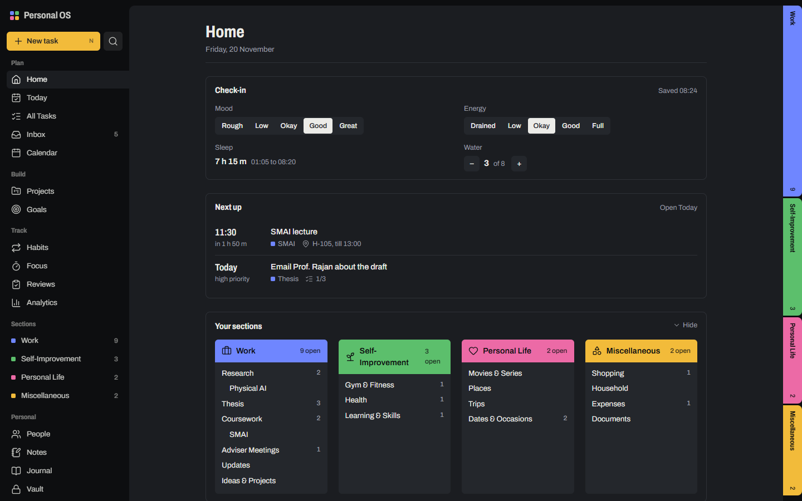

**The idea.** A reference manual open at a tabbed section.

- The four areas are coloured divider tabs down the right edge of the app. Each tab's height is proportional to how much is open there, so the shape of your week is visible at the edge.
- Content sits on a light "leaf" over a dark board.
- Area colour appears at full strength, but only on tabs and area headers.

**Fused from** the challenger world `rw-manual-acetate-tab-board`:

- **Kept:** the fore-edge tab rail, full-strength section hues, condensed headings, and the step-like 90 ms motion.
- **Dropped:** the acetate layers and the serif body (product clarity).

### 1. Personality

Confident and tactile, the most colourful of the three. It feels like a well-made object rather than a website.

### 2. Colour

| Role                          | Light                                         | Dark                                          | Use                                                           |
| ----------------------------- | --------------------------------------------- | --------------------------------------------- | ------------------------------------------------------------- |
| Board                         | `#2a2d32`                                     | `#0d0e10`                                     | The shell around the leaf (sidebar and margins)               |
| Leaf / leaf-2                 | `#fbfbf9` / `#f0f0ec`                         | `#1b1d21` / `#24272c`                         | Content                                                       |
| Ink / muted                   | `#1d1f23` / `#62656c` (5.6:1)                 | `#ecece8` / `#9a9da4` (6.2:1)                 | Text                                                          |
| Work · Self · Personal · Misc | `#2448c8` · `#2a7d3e` · `#c43a7c` · `#e0a015` | `#6f86ff` · `#5cbf6c` · `#ec6aa6` · `#f2bb3a` | Tabs, area heads, done cells (white or ink labels all ≥4.9:1) |
| Danger                        | `#d9431c`                                     | `#ff7650`                                     | Overdue; missed is a dashed red cell                          |

- The primary action in the sidebar is the Misc yellow. Elsewhere it is ink.

### 3. Typography

- **Archivo** in two widths: condensed (78–85%) for titles, group heads and tabs; normal for body and UI.
- 30 px condensed H1, 15 px H2, 14.5 px body.
- It is one family, so it reads as one voice.

### 4. Navigation

- **The left sidebar stays standard**, on the dark board. The active item becomes part of the leaf: it bleeds into the page like an open tab.
- **The right-hand tab rail** is the area index. Clicking an area tab opens that area.
- **On phones**, the tab rail becomes a stepped strip of four tabs under the status bar, with widths ∝ open items.

### 5. Layout and density

- One leaf per page. Inside it, blocks are bordered panels with an 8 px radius.
- Medium density, 40–44 px rows.

### 6. Cards and components

- Area heads on Home are solid colour tabs over a light list.
- Habit cells fill with the habit's area colour when done; skipped is a slash, rest a dot, missed a dashed red outline.

### 7. Buttons and inputs

- 6 px radii.
- The Segmented "on" state is a solid ink key.
- Inputs sit on leaf-2.
- **Motion:** no easing. A two-step 90 ms "hinge" on state changes, as the world specifies; reduced motion makes it instant.

### 8. Icons

lucide at 1.75 stroke. The tabs carry names, not icons.

### 9. Themes

- **Light:** a light leaf on a graphite board.
- **Dark:** a charcoal leaf on near-black, with brighter area colours and dark text on the tabs.

### 10. Desktop and phone

- **Desktop:** sidebar, leaf and tab rail (34 px).
- **Phone:** the stepped tab strip at the top and the dark tab bar below with a yellow ＋.

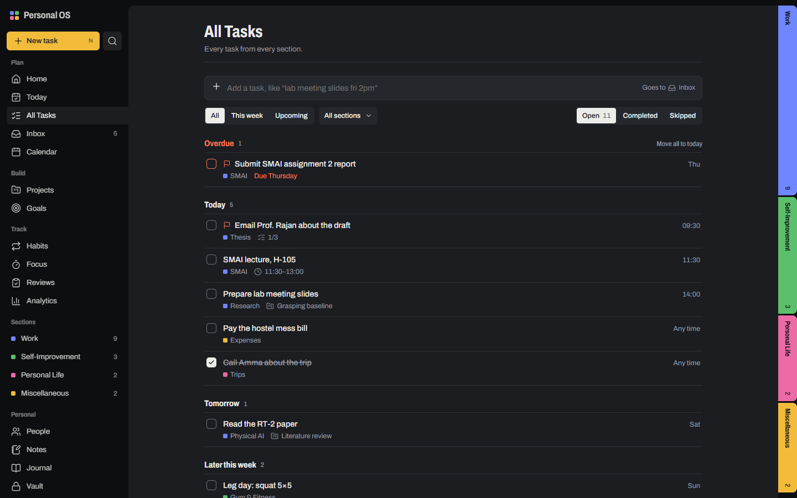
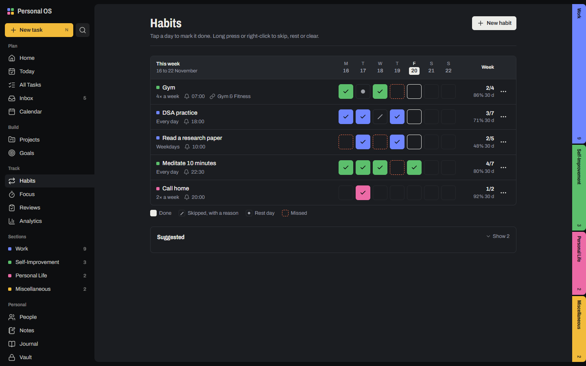
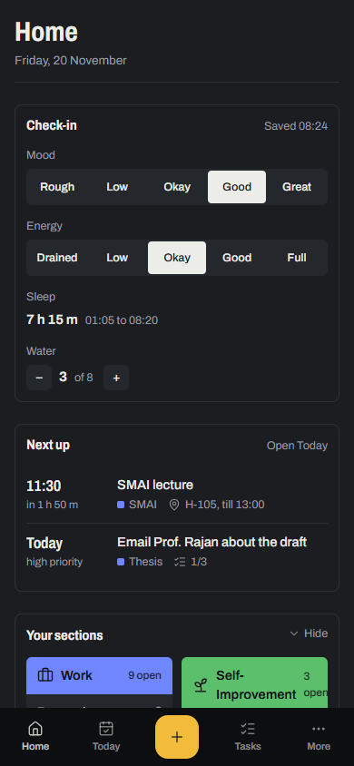

**Honest risk**

- Full-strength colour at the edge of the screen all day may tire the eye. The tab rail costs 34 px of width.
- The tab heights change as tasks close, which is information but also movement in the periphery.
- Done cells in area colour bring colour back into status, which A and C avoid.

---

## C. Lines

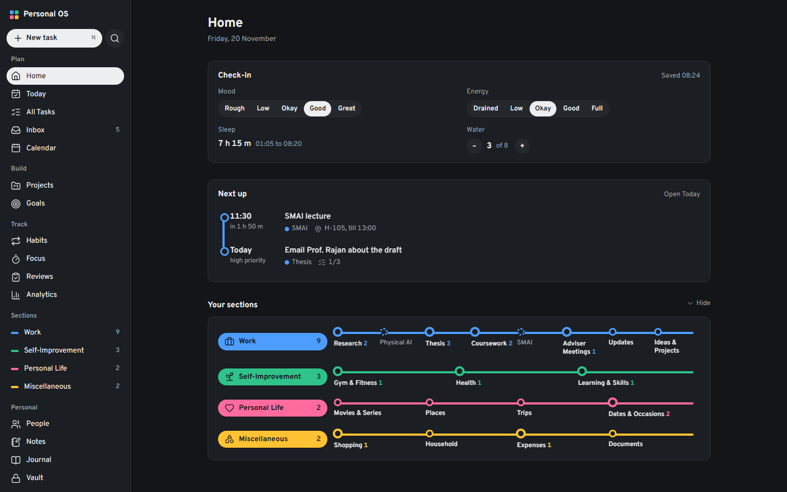

**The idea.** A transit diagram of your life:

- each area is a line in its colour
- sections are its stations
- the day's tasks are stops along the line

**Impeccable's pick.** This was my own top-ranked candidate. It has the clearest link between the area rule and a visual system people already read fluently.

### 1. Personality

Friendly, legible and wayfinding-clear. It feels the most "designed" of the three, and the most immediately understandable.

### 2. Colour

| Role                          | Light                                         | Dark                                          | Use                                                   |
| ----------------------------- | --------------------------------------------- | --------------------------------------------- | ----------------------------------------------------- |
| Ground / surface              | `#f6f7f8` / `#ffffff`                         | `#131518` / `#1b1e22`                         | Page, panels                                          |
| Ink / muted                   | `#1a1d21` / `#5d646e` (5.6:1)                 | `#eceef0` / `#9aa1ab` (6.4:1)                 | Text                                                  |
| Work · Self · Personal · Misc | `#0067c6` · `#007f52` · `#d02a66` · `#b88200` | `#4c9dff` · `#2fc28a` · `#ff6b9d` · `#ffc233` | 4 px lines, stations, line tags (rings ≥3:1 on white) |
| Danger                        | `#d3361d`                                     | `#ff6f52`                                     | Overdue ring, missed stop                             |

### 3. Typography

- **Overpass**, one family. It descends from the US highway signage face, so wayfinding is literally in its letters.
- 24 px H1, 14.5 px H2 and body, tabular numbers.

### 4. Navigation

- A white sidebar with the active item as a solid ink pill.
- Section rows carry a short line swatch instead of a dot.
- On phones, a white tab bar with an ink ＋.

### 5. Layout and density

Panels with a 12 px radius for the check-in, next up and the map. Lists sit straight on the ground. Medium-low density.

### 6. Components

- **Task check:** a station ring in the area's colour. The line runs through consecutive stops in a group, so a run of Work tasks reads as one blue line.
- **Overdue:** a red outer ring.
- **Habit row:** a seven-stop line:
  - filled with a tick = done
  - a slash = skipped
  - a small stop = rest
  - a red mini-ring = missed
  - an outer ring = today

### 7. Buttons and inputs

Pills throughout (999 px), so the radius is a world choice, not a default.

### 8. Icons

- lucide at 1.75 stroke.
- Area terminus tags carry the area icon, like a line badge.

### 9. Themes

- **Light:** almost white and quiet.
- **Dark:** brighter line colours with dark labels on the tags.

### 10. Desktop and phone

- **Desktop:** the section map is four horizontal lines.
- **Phone:**
  - the map lines scroll sideways
  - habit rows put seven 36 px stations under the name
  - the task line keeps a 9 px gutter

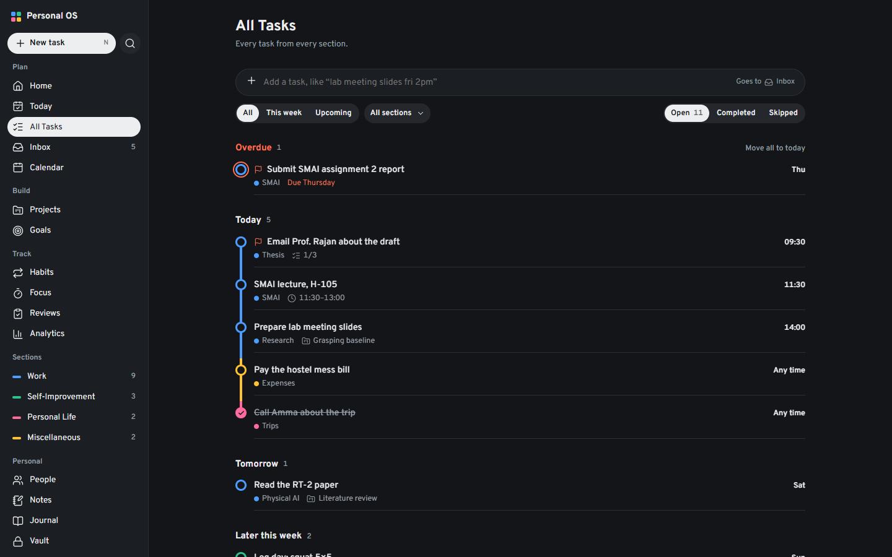
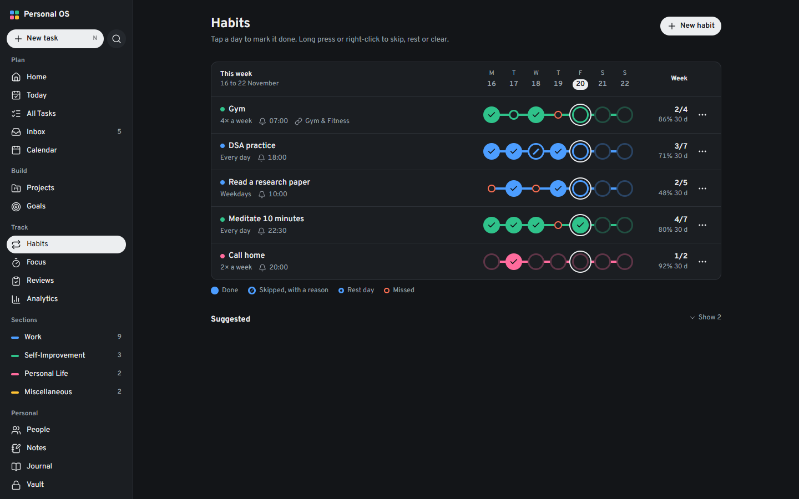
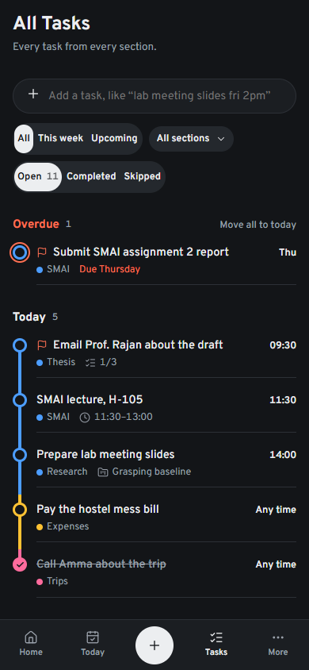

**Honest risk**

- The metaphor is familiar ("subway map" designs are common), so it risks reading as a theme rather than a tool.
- Rings plus lines add visual weight to long lists, so a 40-task Inbox is busier than in A.
- Horizontal map lines don't scale to areas with 10+ sections.

---

## Also available: the category standard

You can always choose the familiar path instead: the current graphite look, refined to the Linear or Things craft bar (one token set, one component kit, no new identity).

It solves the consistency findings but not V1 ("no identity of its own"), which is this redesign's stated goal. It isn't recommended, but it stays on the table.

The other declined challengers are kept for a re-roll:

- the pocket timetable slide rack
- the doujin event catalog
- Japanese high-density web
- the Crouwel grid specimen
- Ikeda datamatics

All of them lost on both axes (audience and clarity) once fused with the product. Their disciplines were added to Direction A, listed above.

## 6. Against the audit

From `CURRENT_UI_UX_AUDIT.md` §5:

| Must fix                           | A. Timetable                                       | B. Divider tabs                          | C. Lines                               |
| ---------------------------------- | -------------------------------------------------- | ---------------------------------------- | -------------------------------------- |
| 1. Identity from the life areas    | ✓ Area as a course code on every row, period rules | ✓✓ The strongest: area tabs own the edge | ✓✓ Areas are the lines                 |
| 2. No cards-in-cards               | ✓✓ Rules, not cards                                | △ Leaf + panels: two levels              | ✓ Panels only for the check-in and map |
| 3. One row anatomy                 | ✓✓ Time · check · title · meta, everywhere         | ✓                                        | ✓                                      |
| 4. Habit states without colour     | ✓✓ Letters in a register                           | ✓ Shapes, plus colour fill for done      | ✓ Shapes on stations                   |
| 5. Phone Tasks starts with tasks   | ✓ Denser filter row                                | ✓                                        | ✓                                      |
| 6. One button kit with all states  | Any direction (Phase 2 work)                       | Same                                     | Same                                   |
| Calm over long sessions            | ✓✓                                                 | △                                        | ✓                                      |
| Fits more of the day on one screen | ✓✓                                                 | ✓                                        | △                                      |

## 7. Recommendation

**Go with A. Timetable.**

1. **It fits an Operate product used all day.** It is the calmest and the densest, and it reads as a tool first. A Linear user would find everything at once, and it is as quiet as Things over a long session.
2. **It answers the hardest findings directly:**
   - the register's letters fix the habit states without relying on colour (C2)
   - the time column gives every task one row anatomy (H3)
   - rules instead of cards remove the nesting (H1)
3. **The signature is useful, not decorative.** "Friday's timetable" is Sunsama's best idea (the day on a time axis) in a form you already read every week. It also makes the roadmap's later load hint (#28) natural.
4. **It keeps the colour rule exactly.** Area colours mark areas, and done stays ink, so colour never has to mean two things.
5. **It is the cheapest to build well.** It changes tokens, rules and row anatomy, not the component model, and it carries over to section pages, Calendar and Analytics with little invention.

**Choose B instead** if you want the boldest, most ownable identity and you're comfortable with strong colour at the edge of the screen. It is the most distinctive, and its tab rail shows information (open counts) that A only shows in the sidebar.

**Choose C** if friendliness and instant legibility matter more than density.

### Decisions needed in Phase 2 (none taken yet)

- **Font package.** The chosen face would need one new dependency, for example `@fontsource-variable/public-sans` for A (`@fontsource-variable/archivo` for B, `@fontsource/overpass` for C). It would replace both Inter and Bricolage, so the project goes from two font packages to one. Phase 1 adds nothing.
- **After you choose**, the direction is written as a contract in `.impeccable/surfaces/`. The build is reviewed by the finish reviewer, then documented in `DESIGN.md`.

**Decision (2026-11-20): A. Timetable is chosen.** The direction contract is in `.impeccable/surfaces/src-app-appshell-tsx.md`. Phase 2 implements it.
